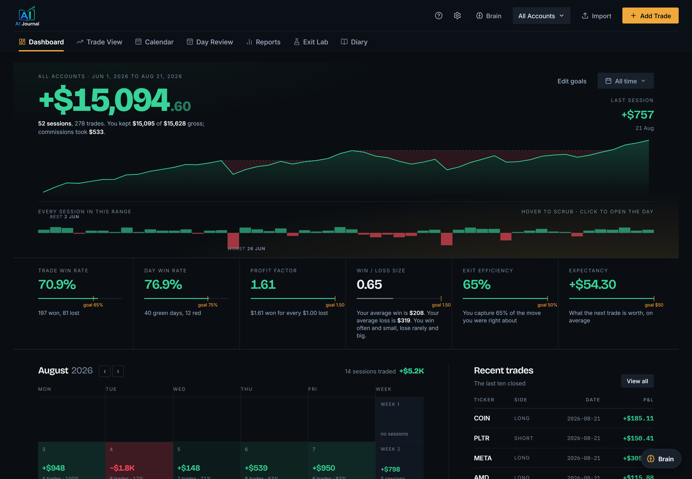
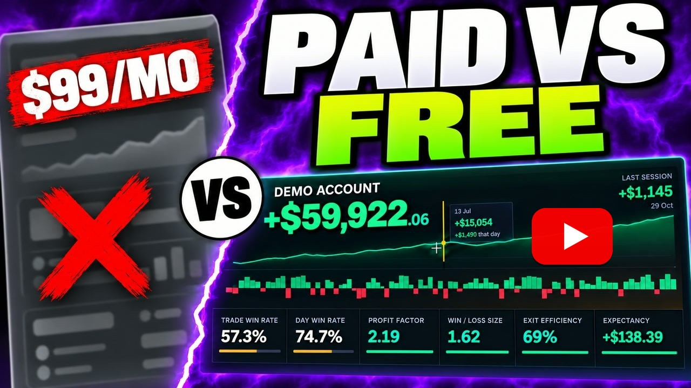
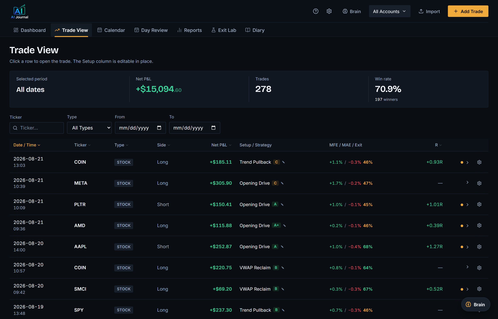
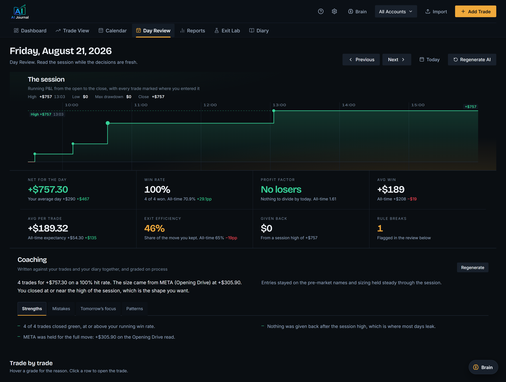
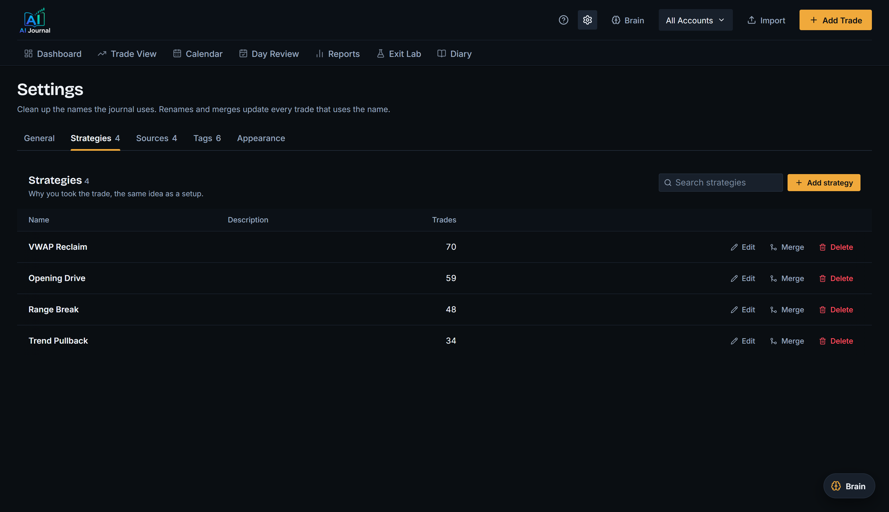
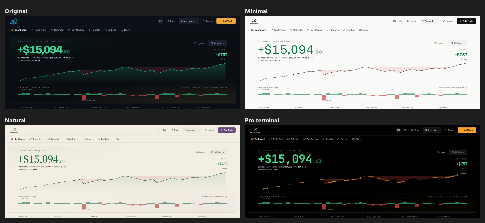

# Trading Journal AI

[](https://github.com/simonro/Trading-Journal-AI/actions/workflows/ci.yml)
[](https://github.com/simonro/Trading-Journal-AI/releases/latest)
[](LICENSE)
[](https://www.youtube.com/watch?v=rsNizd9niG4)

A trading journal that runs on your own machine. Import your broker's CSV and it rebuilds your
round-trip trades, tracks the numbers that matter (win rate, profit factor, expectancy, drawdown,
MFE/MAE, exit efficiency), and, if you want it to, uses Claude to read your trading diary and grade
your days on process.

- **Your data stays on your computer.** One SQLite file, no account, no telemetry.
- **The numbers are not AI.** Trade grouping, P&L, fees and statistics are plain code with tests.
  AI is an optional coaching layer on top.
- **Stocks, options and futures**, with partial fills, scale-ins and shorts grouped automatically.
- **Thinkorswim and Interactive Brokers** importers, seven more in beta (Tradovate, NinjaTrader,
  TopstepX, Webull, tastytrade, TradeStation, Power E*TRADE), and a template for any other broker.
- **Four looks**: Original, Minimal, Natural and Pro terminal, picked in Settings.
- **One-command install**: `docker compose up -d`, or a setup script on Windows, Mac and Linux.
- **Free and MIT licensed.** No paid tier.

**[Quick start](#quick-start)** · **[Watch the walkthrough](https://www.youtube.com/watch?v=rsNizd9niG4)** · **[Releases](https://github.com/simonro/Trading-Journal-AI/releases)** · **[Privacy](#privacy-and-your-data)**

**What this is not:** Not financial advice. Not a signal service. Every screenshot below is the
synthetic demo seed, not anyone's real trades.



## Watch the walkthrough

[](https://www.youtube.com/watch?v=rsNizd9niG4)

[](https://www.youtube.com/watch?v=rsNizd9niG4)

A tour of the current version: the Dashboard, Trade View, Day Review, Leaks and Exit Lab, on a
demo account with synthetic trades. The install and update prompts for Claude Code or Codex are in
the video description, ready to paste.

## Exit Lab

Exit Lab replays your completed stock trades on historical one-minute prices and shows
what other exits would have done with the same entry, size and stop. It describes your
history; it does not predict future results and it places no orders.

- **Exits tab on every trade.** A replay chart with your actual fills and each rule's
  exits, and an outcome table in R and in dollars: Actual, 1R target, 2R target, Hold to
  close, Breakeven after +1R, and any rule you saved.
- **Exit Lab page.** The same rules compared across all your trades, filtered by date,
  symbol, setup and side, each against your own exits on the same trades. Rules can be
  assigned to the setups they are meant for.
- **Advanced rule builder.** R targets, a VWAP touch target, exits after N minutes, at a
  clock time or at the session close, up to 3 scale-out tranches, R-step and ATR trailing
  stops, and VWAP, EMA 9/20 and 5-minute RS/RW indicator exits.

The rules it plays by:

- The stop is the trade's **Stop Loss** in the journal. A trade without one asks you to
  enter it, and that writes the same journal field.
- When a one-minute candle touches the stop and a target, the stop fills first. A gap
  through the stop fills at the worse open.
- Modeled commissions and slippage are zero. Your actual dollars keep the journal's net P&L.
- Trades without complete regular-hours prices are left out with the reason, never filled in.

**Prices.** Exit Lab needs historical minute bars from Alpaca. Add `APCA_API_KEY_ID` and
`APCA_API_SECRET_KEY` to `backend/.env` (a free Alpaca account works: it serves SIP history
older than 15 minutes), then press **Load missing prices** in Exit Lab. One background job
fetches every session and warm-up window your trades are missing, with a progress bar and a
plain list of any that failed. Opening a trade's Exits tab also loads that trade's missing
prices once; its **Load prices** link is the retry. Prices are cached in your database; a
calculation never downloads anything by itself.

**Try it on synthetic trades.** The demo builds its own database,
`backend/exitlab_demo.db`, labeled **Synthetic trades, historical market prices**: generated
trades on real historical minute prices for SPY, QQQ and NVDA. Your journal database is
not opened. After `setup.bat` (a local install, not Docker) and your Alpaca keys, double-click
`scripts\launch_exitlab_demo.bat`, then open http://localhost:3020 and choose the
"Exit Lab demo" account. The first run takes about two minutes to download the prices.
By hand on any OS, with the virtualenv active:

```bash
# from the repo root
python scripts/seed_exitlab_demo.py --fetch   # downloads prices into backend/exitlab_local.db
python scripts/reset_exitlab_demo.py          # builds backend/exitlab_demo.db (--replace to rebuild)

# terminal 1, from backend/
DATABASE_PATH=exitlab_demo.db python -m uvicorn main:app --port 8020

# terminal 2, from frontend/
PORT=3020 REACT_APP_API_URL=http://localhost:8020 npm start
```

On Windows `cmd`, set the variables first: `set DATABASE_PATH=exitlab_demo.db` in terminal 1,
and `set PORT=3020` plus `set REACT_APP_API_URL=http://localhost:8020` in terminal 2.
The [Exit Lab guide](docs/README.md) and the [engine notes](backend/exitlab/README.md)
cover eligibility, fill order and the API.

## Leak Finder

Reports > Leaks ranks the groups of your trades that cost you money, using only what you knew
when you entered, so every leak is something you could have skipped. It describes your history;
it does not predict future results.

- **A leak** is a group of at least 20 trades sharing one thing known at entry (entry window, trade
  number of the day, losses just before, minutes since the last loss, how the day stood, size against
  your usual for that account and ticker, instrument, side, weekday, playbook setup, and the diary
  fields: strategy, source, emotion) whose net is below zero. Size is the first entry only, so a
  later add does not count. Sequence features count every entry of the day, breakeven and open
  trades included, and only trades fully closed before this one was entered.
- **Up to three leaks**, picked greedily: worst first, its trades removed, the rest recomputed. The
  headline total never counts a trade twice, and sits beside your net without the leaks.
- **Confidence** is a Welch t against the rest of the same dimension: 2+ solid, 1-2 likely, under 1
  could be noise.
- **New in the last 30 days**: groups of 10+ trades losing over the last 30 days of the range but not
  over the whole range. **What is working**: the two groups that beat the rest by the most, one per
  dimension.
- **Trade management and costs.** Hold time, scaling out and mistake tags (logged after the trade,
  mostly about what happened in it) are shown beside the leaks and never ranked as one. Hold time
  runs from the first entry to the last exit across days. Commissions and fees are broken down by
  instrument.
- **Show N trades** lists the trades behind a finding; a row opens the trade and Back returns to Leaks.

The rules are plain code in `backend/leaks.py` (pure functions, tested in
`backend/tests/test_leaks.py`), and `/api/leaks` loads the same trades as `/api/reports` (net P&L not
zero, same account and date filters), so the two reconcile. With an Anthropic key,
`/api/leaks/explain` asks Claude for one sentence per finding from the numbers only, cached in the
`leak_explanations` table under a hash of those numbers, so it reruns only when they change. Without
a key the tab keeps its plain template sentences.

## Sync from Edge Trader for Schwab

[Edge Trader for Schwab](https://github.com/simonro/edge-trader-for-schwab) is a separate free app for
placing and managing Schwab orders. It can send its side of your trading day to this journal: your
Schwab fills, the strategy, source, tags, emotion, mistakes and reasons you picked for each trade, the
notes you wrote during it, its stop and target changes, and your day note.

- **Opt-in and click-only.** Nothing happens until you set the journal's address in Edge Trader and
  press **Sync**. Sync first shows a preview of exactly what would change (new trades, fills already in
  the journal, fields that would be written or that conflict with your edits). Nothing is written until
  you press **Apply** on that preview.
- **Backed up first, all or nothing.** Apply copies your database into a `sync-backups` folder next to
  it (the last 10 are kept), then writes everything in one transaction. If the journal changed after
  the preview, Apply is refused and you get a fresh preview instead.
- **Your journal edits win.** A field you changed or cleared in the journal is never overwritten; the
  preview lists it as a conflict. A tag or a day note you removed here stays removed (a day note
  comes back only if you edit it again in Edge Trader).
- **No duplicates.** Fills already in the journal, from an earlier sync or a Thinkorswim statement
  import, are recognised and not added again, whichever comes first. Each instrument (stocks, options,
  futures) goes to the journal account you pick, and the preview lets you send one trade elsewhere.
  Two option legs filled together become one vertical at the net price, as in a statement import.
- **What you see.** Trade Details gets a **Timeline** of the trade's stops, targets and notes (point at
  an event to see it on the chart, click to keep it there), stock charts draw the stop and target
  history, and the Diary and Day Review show your Edge Trader day note.

**Point Edge Trader at the journal.** In Edge Trader's Journal settings, set the address to
`http://127.0.0.1:8010` (the same for the setup-script and Docker installs; use your own port if you
changed `JOURNAL_API_PORT`) and pick a journal account for each instrument. Edge Trader's own server
sends the sync, not your browser, so no CORS or network settings change: the journal keeps listening on
this computer only. For the same reason the journal refuses a sync request that comes from a web page
(one that carries an `Origin` header), even a page served from this computer.

The endpoint is `POST /api/sync/edge-trader` (`dry_run: true` returns the preview and a `state_token`;
Apply sends the same request with `dry_run: false` and that token), with `GET /api/sync/info` for the
version check. The code is `backend/edge_sync.py` and `backend/schwab_adapter.py`, tested in
`backend/tests/test_edge_sync.py`.

## Privacy and your data

Trading Journal AI is designed as a **local-first application**.

Your trading journal database, imported broker data, notes, and uploaded files are stored locally on your computer. Trading Journal AI does not require an account and does not include telemetry or analytics that send your usage data back to the project. The backend listens on `localhost` only.

### What stays local

- Your trading database
- Imported broker CSV files
- Trade history and performance data
- Journal entries and notes
- Uploaded diary files and images
- Application settings

### Optional external services

Some features use third-party APIs and are completely optional.

**Claude / Anthropic**

When you use AI analysis or the Brain assistant, the information required to answer your request may be sent to Anthropic's API. This can include trade information, journal context, or images you explicitly ask the AI to analyze.

With a key set, opening Reports > Leaks sends each finding's group name and totals (trade count, net, per-trade average, win rate) to write its one-sentence explanation. Individual trades and trade ids are not sent.

The core journal, trade reconstruction, P&L calculations, reports, and statistics do not require Claude.

**Market data (Alpaca)**

If you add Alpaca keys, the trade chart and Exit Lab's **Load missing prices** and **Load prices** ask Alpaca for price bars:
the ticker (plus SPY for Exit Lab) and the date range, nothing about your trades or account.

**Update check (GitHub)**

When the backend starts, it asks GitHub's public releases page whether a newer version exists, at
most once a day (the answer is cached in `backend/update_check.json`, or in the data volume under Docker). That is one anonymous request
to `api.github.com`: GitHub sees your IP address and the app version, nothing about your trades,
keys or settings. If a newer release exists you get a notice in the app and a line in the backend
window; nothing is ever downloaded or installed for you. Offline, it stays silent. Turn it off with
`UPDATE_CHECK=0` in `backend/.env`.

**Edge Trader for Schwab sync (only if you use it)**

A sync goes from Edge Trader, running on your computer, to the journal, also on your computer. With
an Anthropic key set, Apply then asks Claude for short feedback on the trades that got new picks or
notes, and fills blank fields (reasons, mistakes, emotion) only where your notes support them. For that,
those trades' fills, stop and target events, your notes and the fields you filled in are sent to
Anthropic's API. Without a key, the sync contacts nothing outside your computer.

**Docker (only if you use it)**

`docker compose up` downloads the official Python, Node and nginx base images from Docker Hub the
first time, like any Docker build. Nothing about you or your trades is sent; your data stays in a
volume on your computer.

### API keys

API keys are configured locally and should never be committed to GitHub.

Do not share or commit:

- `.env` files
- API keys or secrets
- Local database files
- Raw broker statements containing personal information
- Screenshots containing account numbers or other sensitive financial information

The repository's `.gitignore` is configured to exclude common local data and credential files.

### Deterministic calculations

AI is not used to calculate your trading results.

Trade reconstruction, P&L, commissions, statistics, and other core trading calculations are handled by deterministic application code. AI features are an optional analysis and coaching layer on top of those calculations.

## What's inside

- **Dashboard**: your net P&L over a live equity curve (hover it for any day's running balance),
  every session in the period as a single strip you can scrub, measures against your own goals,
  the month beside your recent trades and open positions, and a tabbed breakdown by time of day,
  day of week and strategy
- **Exit Lab**: replays your stock trades on minute prices to compare alternative exits in R and dollars, per trade and across all trades
- **Trade View**: every trade with executions, playbook setup tags, MFE/MAE and exit efficiency, its AI analysis and an intraday chart with your fills on it. The gear on each row moves a trade to another account (its notes and tags go with it) or deletes it
- **Accounts**: tick several accounts in the header menu to see them together, or delete an account (the database is backed up first)
- **Reports**: breakdowns by day of week, time of day, hold time, setup, grade, symbol, side, emotion,
  plus a Sources & Tags tab that scores where your ideas come from. One switch flips the whole page
  between bars and full numeric tables, and rows under ten trades are marked thin so a one-trade
  strategy at 100% cannot sit at the top. A Leaks tab ranks what costs you money
  (see [Leak Finder](#leak-finder))
- **Edge Trader sync**: fills, picks, notes, stop and target changes and a day note from Edge Trader for Schwab, on your click (see [Sync from Edge Trader for Schwab](#sync-from-edge-trader-for-schwab))
- **Diary**: upload handwritten notes, screenshots, or typed text; Claude extracts strategy, stops, R-multiples, emotional state, and mistakes, and matches them to your actual trades
- **Day Review**: the session drawn as one picture, running P&L from the open to the close with every
  trade marked where you entered it, plus an AI coaching report graded on process rather than P&L.
  Each trade's grade carries the reason it was given
- **Brain**: a chat that answers questions against your full trading history
- **Settings**: the name library. Strategies, sources and tags in one place, with rename, merge and
  delete. Merging rewrites every trade that used the old name and remembers it, so the next diary
  analysis that produces the duplicate saves it under the name you kept. Appearance picks one of
  four themes (colors, fonts and chart style only; every page keeps the same layout), saved in your
  browser
- **Import**: Thinkorswim account statement CSV and Interactive Brokers (IBKR) Activity Statement CSV, with a broker dropdown (auto-detect by default). Tradovate, NinjaTrader, TopstepX, Webull, tastytrade, TradeStation and Power E*TRADE exports import in beta (see [Beta broker importers](#beta-broker-importers)). Any other broker imports through a generic CSV template, one row per fill. Thinkorswim option
  spreads: a vertical is one trade at its net price, while calendar, diagonal and custom orders keep every leg

## Screenshots

**Trade View.** Every trade with its executions, MFE/MAE and exit efficiency, the realized R, and the
setup you tagged. Click any row to open the full trade.



**Trade Details.** The executions on one trade, the planned and realized R, the stop and target you
wrote before entry, and an intraday chart with your fills marked on it. Charts open on the trade
day's session; the legend entries switch layers on and off.


**Day Review.** The session as one picture: running P&L from the open to the close with every trade
marked where you entered it. The day's measures sit under it, each set against your all-time figure:
win rate, profit factor, average win, average per trade against your expectancy, exit efficiency,
and how much was given back from the session high. Underneath, an AI coaching report graded on process rather than P&L,
which reads your trades and your diary together and is willing to tell you a profitable day was
badly run.



**Reports.** Equity curve, drawdown against the running peak, and breakdowns by setup, timing,
execution, symbol, source, tag and psychology.


**Settings.** The vocabulary the journal uses. Rename a strategy, merge two that mean the same thing,
or delete one and reassign its trades.



**Themes.** Settings > Appearance switches the whole app between four looks: Original, Minimal,
Natural and Pro terminal. Only colors, fonts and chart style change; every page keeps its layout.



## Quick start

Pick one. Every install starts on http://localhost:3010.

### Option 1: Docker, one command

Needs [Git](https://git-scm.com/downloads) and [Docker Desktop](https://www.docker.com/products/docker-desktop/)
(Windows, Mac), or on Linux Docker Engine with the
[Compose plugin](https://docs.docker.com/compose/install/linux/) 2.24 or newer (`docker compose version`).
No Python or Node on your machine.

```bash
git clone https://github.com/simonro/Trading-Journal-AI.git
cd Trading-Journal-AI
docker compose up -d
```

Open http://localhost:3010. The first start builds the app, which takes a few minutes; later starts
take seconds. It keeps running in the background and comes back after a reboot whenever Docker is
running. Stop it with `docker compose down`.

- **Your trades** live in the `journal-data` Docker volume, not in the folder, so updating or
  deleting the folder never touches them. Only `docker compose down -v` deletes the volume, and
  with it your journal.
- **API keys** (optional): copy `.env.example` to `backend/.env`, fill in the keys, then run
  `docker compose up -d` again.
- **Backup**: stop the backend so SQLite finishes writing, copy the whole data folder (database and
  uploaded diary images), then start it again:

  ```bash
  docker compose stop backend
  docker compose cp backend:/data ./journal-backup
  docker compose start backend
  ```
- **Other ports**: set `JOURNAL_PORT` (frontend) and `JOURNAL_API_PORT` (backend) before
  `docker compose up -d --build`. The backend address is built into the frontend, so a port change
  needs the `--build`.
- Both ports listen on `127.0.0.1` only. The journal has no login, so other machines cannot reach it.

Docker is the easy way to run the journal. If you want to change the code with Claude Code (see
[Make it yours](#make-it-yours-with-claude-code)), use option 2: edits show up instantly there,
while Docker needs a rebuild after each change.

### Option 2: setup script (Windows, Mac, Linux)

Needs [Python 3.11+](https://www.python.org/downloads/) and [Node.js 18+](https://nodejs.org/) (the
current LTS is recommended). Download or clone the repo, then:

| | Windows | Mac and Linux |
|---|---|---|
| Once | double-click `setup.bat` | `bash setup.sh` |
| Every time | double-click `launch.bat` | `bash launch.sh` (Ctrl+C stops it) |

Setup creates the Python environment in `.venv`, installs everything and creates `backend/.env` for
your optional keys. Running it again is safe. Then open http://localhost:3010.

**By hand, if you prefer:**

```bash
# 1. Python environment + backend dependencies
python -m venv .venv
.venv\Scripts\activate         # Windows (source .venv/bin/activate on Mac/Linux)
pip install -r backend/requirements.txt

# 2. Frontend dependencies
cd frontend
npm ci
cd ..
```

Then start the FastAPI backend on port 8010 from `backend/` with
`python -m uvicorn main:app --reload --port 8010`, and the React frontend on port 3010 from
`frontend/` with `PORT=3010 npm start` (on Windows: `set PORT=3010&& npm start`).

To run them on other ports, tell each side about the other: `REACT_APP_API_URL` for the frontend,
and, only if the frontend is not on localhost, `FRONTEND_ORIGINS` (comma separated) for the
backend's CORS allow list. Any localhost port is accepted without configuration.

Every install starts empty: no accounts, no trades, no demo data. Add your first account in the app,
then import your broker's statement on the Import page.

## Updating to a new release

When a newer release is out, the app shows a notice at the top of the page with a link to the
release notes (how the check works is under [Privacy](#privacy-and-your-data)). It never updates itself;
you choose when, with the steps below.

Your trades live in `backend/trading_journal.db` and your keys in `backend/.env`. Neither is part of
a release, so an update never touches them. New tables are created on the first start and nothing
existing is rewritten.

**Docker:**

```bash
git pull
docker compose up -d --build
```

Your trades stay in the `journal-data` volume. Copy a backup out first (command in
[Quick start](#quick-start)) if you have trades you care about.

**If you cloned with git (setup script install):**

```bash
git pull
setup.bat          # Mac/Linux: bash setup.sh. Installs whatever changed, safe to repeat
launch.bat         # Mac/Linux: bash launch.sh
```

**If you downloaded the ZIP:** unzip the new version into a new folder, then copy your two files
across before starting it, plus the `uploads` folder if you have uploaded diary images:

```bash
copy old-folder\backend\.env               new-folder\backend\.env
copy old-folder\backend\trading_journal.db new-folder\backend\trading_journal.db
xcopy /e /i old-folder\backend\uploads     new-folder\backend\uploads
```

Then run `setup.bat` (`bash setup.sh` on Mac/Linux) once in the new folder and start it with `launch.bat` (`bash launch.sh`).

Back up `trading_journal.db` first if you have trades you care about. It is a single SQLite file, so
copying it somewhere safe is the whole backup.

To check what changed, see the [releases page](https://github.com/simonro/Trading-Journal-AI/releases).

**Re-importing a day after an import fix.** An import skips fills that are already stored, so a
plain re-import leaves old rows as they were. Open the day, delete the affected trades with the gear
on each trade row (Delete trade; notes and tags on them go too), then import that day's statement again.
v1.5.2 needs this for Thinkorswim days with option spreads, which earlier versions overstated.

**v1.7.1 fixes how some trades were grouped.** A single fill that flipped your position (long 100,
then one sell of 200) used to turn the whole sequence into one open trade with no P&L, and so did
fractional shares that added up to a closed position. New imports are right. Trades already stored
stay as they were, because a re-import skips fills it already has: to correct a day, delete its
trades with the gear on each trade row and import that day's statement again. Profit factor now
uses net P&L on both sides (fees included), and open positions no longer count in win rate or
expectancy, so both numbers can change slightly.

**v1.6.0 updates the database on first start.** Notes and tags are now kept per account, so two
accounts with a trade of the same name each keep their own. Existing notes stay on the trades they
belong to; nothing needs to be re-imported. Back up `trading_journal.db` before the first start, as
with any update.

## Beta broker importers

Tradovate (Orders), NinjaTrader (Executions), TopstepX (trades), Webull (order history), tastytrade
(transactions, with expirations and assignments), TradeStation (activity) and Power E*TRADE exports
have their own importers. They are **beta**: they were built from the brokers' documented column
layouts and tested on sample files, not yet on many real accounts. Pick the broker on the Import page
to see where its export lives in the broker's app.

- For the exports whose times carry no zone (all but tastytrade) you pick the timezone the file's
  times are in; the journal remembers it per account.
- A file that holds several broker accounts asks which one to import.
- The Tradovate and Power E*TRADE exports have no commissions, so fees come in as $0.

**Help make them solid:** if a beta importer misreads your file, or your broker's export looks
different, [open an issue](https://github.com/simonro/Trading-Journal-AI/issues/new) with a sample
export that has the account numbers and personal details removed (a few days of fills is enough).
The column readers for Tradovate, NinjaTrader, TopstepX and Webull are based on LuxAlgo's MIT-licensed
trade-journal importers; see [THIRD_PARTY_NOTICES.md](THIRD_PARTY_NOTICES.md).

## Importing from a broker that is not listed

Thinkorswim and Interactive Brokers have dedicated importers, and the brokers above have beta ones.
For anything else, use the generic
template: one row per fill, which the journal groups into round-trip trades exactly like a broker
import. On the Import page, open **Broker not listed?** to download it.

- Blank template: [`frontend/public/templates/generic_trades_template.csv`](frontend/public/templates/generic_trades_template.csv)
- Worked example: [`frontend/public/templates/generic_trades_example.csv`](frontend/public/templates/generic_trades_example.csv)
  (a long with a partial exit, a short, an option and a micro future)

| Column | Needed | What goes in it |
|---|---|---|
| `date` | Required | `YYYY-MM-DD`, or `MM/DD/YYYY`. Day-first dates are refused because `03/04` is ambiguous |
| `time` | Required | 24 hour `HH:MM` or `HH:MM:SS`, or `1:05 PM` |
| `symbol` | Required | `AAPL`. Futures start with a slash: `/MESU26` |
| `side` | Required | `BUY` or `SELL`. `BUY TO COVER`, `SELL SHORT`, `BOT` and `SOLD` work too |
| `quantity` | Required | Shares or contracts, always positive |
| `price` | Required | Fill price per share or per contract |
| `commission` | Optional | Fees for that fill. Blank means 0 |
| `asset_type` | Optional | `STOCK` (the default), `OPTION` or `FUTURE` |
| `expiry`, `strike`, `put_call` | Options | `2026-08-28`, `765`, `CALL` or `PUT`. Options use a 100 multiplier |
| `multiplier` | Optional | Point value for a future the app does not know, for example `50` for `/ES` |

Columns can be in any order, common names such as `Ticker`, `Qty` and `Fees` are recognised, and
extra columns are ignored, so an export that already uses these headers imports without editing.

If any row cannot be read, **nothing is imported** and the error names the line and the problem. A
silently skipped fill would change every P&L figure after it, so the importer refuses instead.

Adding a dedicated parser for your broker is welcome: open an issue with a sample export that has
the account numbers and personal details removed, or send a pull request against
`backend/csv_parser.py`. Every parser only has to produce execution rows; grouping, duplicate
detection and P&L are shared.

## Environment variables

Copy `.env.example` to `backend/.env` and fill in the keys yourself, or ask Claude Code to do it:

**Add your API keys:**

> Copy .env.example to backend/.env. Then ask me for my Anthropic API key, and after that my Alpaca key ID and secret key, one at a time. Write each one into the matching line in backend/.env exactly as I paste it. Do not print any of them back to me or log them anywhere else. When all three are in, tell me to restart launch.bat.

Everything is optional; the app runs without any keys and tells you exactly which feature each missing key disables.

| Variable | Enables |
|---|---|
| `ANTHROPIC_API_KEY` | Diary analysis, Day Review, Weekly Summary, Insights, and the Brain chat |
| `APCA_API_KEY_ID` / `APCA_API_SECRET_KEY` | Intraday price charts on each trade and Exit Lab's historical minute prices (free Alpaca account works) |
| `ALPACA_ENV_FILE` | Optional. Path to another `.env` file that holds the Alpaca keys for Exit Lab. When set, Exit Lab reads its keys only from that file. |
| `ALPACA_DATA_FEED` | Optional, defaults to `iex` (free-tier data). Set to `sip` only if your key has a paid market-data subscription. |
| `FRONTEND_ORIGINS` | Optional. Any `localhost`/`127.0.0.1` port is already accepted; add comma-separated origins here only for a frontend served from another host. |
| `UPDATE_CHECK` | Optional. `0` turns off the once-a-day check for a newer release on GitHub. |

## Make it yours with Claude Code

This whole app was built by describing problems to Claude Code, one session at a time: "my spreadsheet can't group partial fills", "I want my handwritten diary matched to my trades", "show me when in the day I lose money". No web framework expertise required to get here, and none required to make it yours.

This repo is meant to be adapted, and the fastest way is to point Claude Code at it. A ready-to-paste prompt:

**Adapt the importer to your broker:**

> Read backend/csv_parser.py. It parses Thinkorswim account statement CSVs and Interactive Brokers Activity Statement CSVs: each broker parser reads execution rows (date, time, buy/sell, quantity, symbol, price, fees) into a common execution dict shape (action BOT/SOLD, qty, ticker, price, instrument_type, date, iso_date, time, amount, commission) and hands them to build_trades_from_executions, which groups them into round-trip trades by position open/close cycles and de-duplicates against the database. Here is a sample CSV export from my broker (pasted below / attached). Write a parse_<broker>_csv function for my broker's format following parse_ibkr_csv as the template, register it in BROKER_PARSERS and BROKER_LABELS, teach detect_broker to recognise the file, and add the broker to the BROKERS dropdown in frontend/src/components/Import.js with its export instructions. Keep the duplicate-detection fingerprints working.

## Contributing

Bug reports, broker samples and pull requests are welcome. [CONTRIBUTING.md](CONTRIBUTING.md) covers
the setup, the tests to run and how to add a broker importer. Please report security problems
privately, as described in [SECURITY.md](SECURITY.md), not in a public issue.

## More free tools from Tape to Edge

Same rules for each one: free, MIT, runs on your own machine, and the build is on the [YouTube channel](https://www.youtube.com/@tapetoedge).

- [Edge Trader for Schwab](https://github.com/simonro/edge-trader-for-schwab): order tickets, live R, break-even and trailing stops on the Schwab API, with an opt-in sync into this journal.
- [Edge Scanner](https://github.com/simonro/edge-scanner): a real-time intraday stock scanner with a browser dashboard you lay out yourself.
- [Edge GEX Lab](https://github.com/simonro/Edge-GEX-Lab): a live gamma exposure (GEX) map for SPY, QQQ, SPX, NDX and stocks, with walls, gamma flip and regime.
- [AI Research Desk](https://github.com/simonro/ai-research-desk): three AI research teams debate one stock into swing and long-term calls.

## Who made this

Simon, a day trader. I built this because the journals I was paying for made me fill in forms hours
after the trade, and I never kept it up. I am not a programmer; this was built by describing problems
to Claude Code, and the prompts are in the video description.

- YouTube: [@tapetoedge](https://www.youtube.com/@tapetoedge), where I show what I build and how
- X: [@tapetoedge](https://x.com/tapetoedge)

I take no affiliate money from any broker or tool, and this app has no paid tier, no account and no
telemetry. If it is useful, fork it.

Educational content, not financial advice. I have no affiliate relationship with anything I show or
use, ever.

## License

MIT. See [LICENSE](LICENSE).
